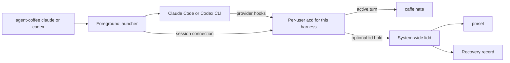

# Agent Coffee architecture plan

Start Claude Code with `agent-coffee claude` or Codex CLI with `agent-coffee codex`. Each opens the harness in the current project, with its usual interface, authentication, and approval prompts. Agent Coffee keeps the Mac awake during an active agent turn. When the agent finishes and waits at the prompt, the session stays available and normal sleep becomes eligible again.

Foreground launches, YAML configuration, hook-driven idle/display assertions, and the shared lid helper are implemented. On-battery lid behavior is pending hardware verification.

## Commands and config

| Command | Behavior |
| --- | --- |
| `agent-coffee claude` | Start a managed Claude Code session in the current directory. |
| `agent-coffee codex` | Start a managed Codex CLI session in the current directory. |
| `agent-coffee config` | Create the user config with defaults on first use, then open it in the user's editor. |

The launcher accepts exactly the two supported harness names. Launch each installed executable directly as the current user and report a missing installation by name. A direct invocation of `claude` or `codex` outside Agent Coffee uses the provider's regular behavior.

**Configuration file:** `~/.agent-coffee/config/config.yml`. The example opts both harnesses into lid protection during active turns and allows the display to sleep.

```yaml
defaults:
  lid_closed: true
  keep_display_on: false
  max_awake: "90m"

# Optional override for Claude Code
claude:
  max_awake: "60m"
```

The built-in defaults allow normal lid and display sleep, and set the turn limit to 90 minutes. Apply the file's `defaults` mapping, then its optional `claude` or `codex` mapping. Explicit false values override true values. Validate keys, types, and a positive finite duration before launching. Read config once per new session. Show an actionable setup error if the user selects lid protection before installing the helper.

## Foreground session and turn lifecycle



**One supervisor per harness session.** Start the selected harness with the caller's terminal, project directory, and environment. Keep the terminal session open while the agent works. After reopening the lid, the user returns to the same terminal. The launcher keeps a session connection to its harness daemon. All terminals running the same harness share that daemon. The daemon tracks active turns in memory and releases them when the launcher disconnects.

**Hooks identify work.** At launch, register the matching provider's hook adapter using a supported configuration mechanism. Preserve existing hooks and scope events to the launched session through a private session endpoint and ID. If the provider requires user-level hook registration, the adapter exits immediately for unmanaged sessions. Verify the registration and event sequence against each supported CLI version. Keep prompts, API keys, terminal contents, and transcripts out of power-state records. [Codex hooks](https://developers.openai.com/codex/hooks) · [Claude Code hooks](https://code.claude.com/docs/en/hooks)

| Event | Power behavior |
| --- | --- |
| Harness opens | Preserve current turn state. Opening a prompt alone needs no assertion. |
| User submits a prompt | Start a bounded turn hold. Record provider, session, turn identifier where available, and absolute expiry. |
| Agent requests approval | If the adapter can reliably detect both wait and resume, release while waiting and reacquire for the remaining time on resume. Otherwise retain the bounded hold and disclose that behavior for the provider version. |
| Turn finishes, fails, or is interrupted | Release its holds. Handle duplicate events idempotently and prevent stale stops from releasing a newer turn. Validate ordering where stable turn IDs are unavailable. |
| Deadline arrives | End protection for that turn and report expiry in the terminal. The harness can continue under normal power policy. |
| Harness or supervisor exits | Release outstanding holds and close the session. Never replay an agent prompt after a crash. |

Verify `UserPromptSubmit` and `Stop` first, followed by Codex `Interrupt`, Claude `StopFailure`, session end, and stop-hook continuation. Bound missing completion events with the original deadline. If power control fails mid-turn, let the agent continue and expose degraded protection to the user.

**Idle, display, and lid.** Keep one timed `/usr/bin/caffeinate -i -t SECONDS` process per active turn. Add `-d` only when requested. Run it separately from the harness so it can end between turns and expire on time. For `lid_closed: true`, also request a hold with the same deadline from a shared privileged helper. The helper serializes changes to the machine-wide `pmset disablesleep` setting. Run the harness, terminal, and hooks with user privileges. An administrator installs the root-owned helper under `launchd` and authorizes a local user. It authenticates socket peers and accepts only bounded lid operations for their own holds. [Apple's caffeinate manual](https://github.com/apple-oss-distributions/PowerManagement/blob/main/caffeinate/caffeinate.8) · [Apple's pmset source](https://github.com/apple-oss-distributions/PowerManagement/blob/main/pmset/pmset.m) · [Apple's launchd guide](https://developer.apple.com/library/archive/documentation/MacOSX/Conceptual/BPSystemStartup/Chapters/CreatingLaunchdJobs.html)

Give each harness daemon a socket in a user-private directory and each launch a random session ID. Match the session and turn before releasing a hold. A saved PID alone can be reused by another process.

## Restoring the lid setting

A killed process cannot run deferred cleanup. The privileged helper owns restoration independently of the task, worker, and terminal.

| Event | Helper behavior |
| --- | --- |
| First lid hold | Read the effective prior value. Persist the original value and pending change atomically and durably before applying the override. Verify the new value before acknowledging. If the prior value is ambiguous, fail before mutation. |
| Another lid hold | Serialize acquisition and store an owner, ID, and deadline for each active hold. Repeated requests with the same ID are idempotent. |
| Session supervisor disconnects, releases a completed turn, or reaches its deadline | Remove its hold. Keep the override while another valid hold exists. The helper enforces deadlines independently of each worker. |
| Last lid hold ends | Restore the original value if Agent Coffee changed it. Verify restoration before clearing the recovery record. Preserve a pre-existing enabled override. |
| Helper crashes or Mac restarts | Configure startup recovery at boot and restart after a crash. Invalidate disconnected holds and reconcile the recovery record before serving new requests. Affected sessions report lost protection. |
| Restoration fails or another tool changes the value | Keep the recovery record and expose the error. Retry failed restoration while the observed setting matches the owned override. Respect a detected external change. Another tool writing the same value is indistinguishable. |

Keep the helper binary, launch configuration, socket parent directory, and recovery record under administrator-controlled ownership. During uninstall, stop accepting holds and confirm restoration before removing the helper. Idle-only use needs no privileged installation.

## Build order and acceptance

| Milestone | Estimate | Finish line |
| --- | --- | --- |
| 1. Launch your own harness | 45–60 min | Parse the config, start the selected harness in the current repo, and submit a normal prompt. Test both command names, an explicit false override, invalid config, and a missing provider. |
| 2. Protect a real turn | Two 60-min sessions | Wire one provider's start and finish hooks to the existing timed idle assertion. Then add the second. Watch a hold appear during work and disappear while the provider stays open. Test the open-lid display with normal idle settings and again with `keep_display_on: true`. Run both harnesses concurrently and finish them in either order. |
| 3. Prove lid behavior on this Mac | 45–60 min | On battery, on a ventilated desk with external displays disconnected, record the prior setting and run a supervised closed-lid test. Confirm progress before reopening and normal lid behavior after restoration. |
| 4. Automate lid restoration | Three to five 60–90 min sessions | Implement the helper and journal. Inject failures before and after setting changes. Verify original values on/off, overlapping turns, killed supervisor, killed helper, reboot, and uninstall. |

**Release demonstration.** Enable lid protection, start a foreground agent on battery on a ventilated desk, and submit a task with a timestamped result. Leave Terminal open and close the lid. On reopening it, verify that the task completed before the lid opened, its result is visible in the original terminal, and the helper restored the prior sleep setting. Repeat with a deadline shorter than the turn and verify restoration at expiry. [Apple's operating-temperature guidance](https://support.apple.com/en-us/102336)
