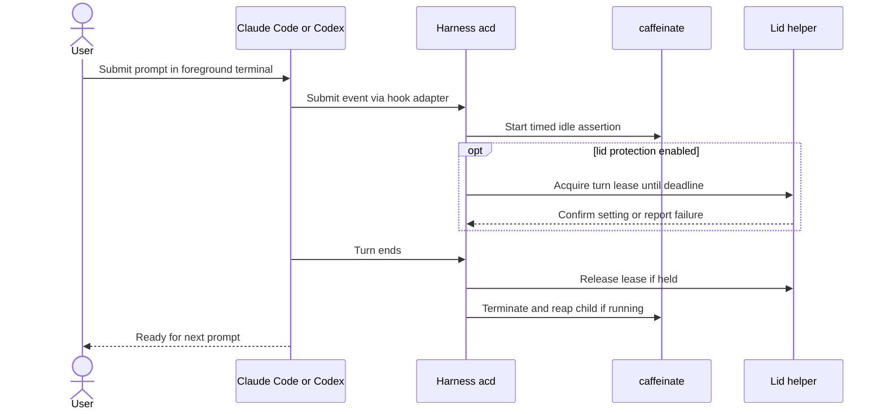

# Agent Coffee v1 low-level design

**Implementation status.** Each foreground launcher keeps one session connection to its harness daemon. All Codex launches for a user share `acd codex`; Claude launches share `acd claude`. Both use the same machine-wide `lidd`. Physical lid-close verification is pending.

## 1. What happens during one prompt

A user runs `agent-coffee codex` and enters a prompt. Codex owns the terminal. A submit hook tells the harness daemon to start a turn. The harness daemon starts a bounded `caffeinate` child and, if configured, acquires a lid hold from the system helper. When the user closes the lid, the existing foreground session continues if macOS honors the lid setting. On completion, the stop hook releases that turn's holds while Codex remains open for the next prompt.



The helper restores the original setting after the **last** live lid lease ends. The deadline releases power protection even if the provider never sends a stop event.

## 2. CLI and configuration

| Entry point | Contract |
| --- | --- |
| `agent-coffee claude` / `agent-coffee codex` | Resolve the named executable on the user's PATH, load settings, prepare hooks and start the provider in the current directory with inherited terminal streams and environment. Missing executable, invalid config, or a required helper unavailable at startup produces a diagnostic on stderr before launching. |
| `agent-coffee config` | On first use, create the config directory with mode 0700 and file with mode 0600 using exclusive creation. Open the existing or new file in the user's editor. Preserve user edits on subsequent calls. |
| Internal hook entry point | Read provider JSON from stdin, extract lifecycle metadata, send one event to the harness acd, and emit the provider's neutral response. Execution is local and time-bounded. |

Read `~/.agent-coffee/config/config.yml` once per launch. A missing file selects built-in defaults. This example enables lid protection for both providers and a shorter deadline for Claude.

```yaml
defaults:
  lid_closed: true
  keep_display_on: false
  max_awake: "90m"
claude:
  max_awake: "60m"
```

Decode the optional `defaults`, `claude`, and `codex` mappings with a strict YAML decoder. Use pointer fields in the input struct so an explicit false overrides true. Apply built-ins (false, false, 90 minutes), file defaults, then provider settings. Reject unknown fields, duplicate keys, invalid types, and nonpositive or unrepresentable durations. Parse durations with `time.ParseDuration`. Check whole-second conversion against the numeric range supported by the installed tool. Invalid config messages identify the path and offending field.

## 3. Go code boundaries

| Source | Responsibility |
| --- | --- |
| [main.go](../main.go) | Dispatch CLI commands and propagate exit status. |
| [internal/config](../internal/config) | Load, merge, validate, and edit the YAML configuration. |
| [internal/harness](../internal/harness) | Launch the foreground harness, maintain its daemon connection, and register and forward provider hooks. |
| [internal/acd](../internal/acd) | Start one daemon per user and harness. Own turn timers, assertion children, and lid leases. |
| [internal/lidd](../internal/lidd) | Authenticate socket peers, read and write the macOS sleep setting, serialize leases, and recover the prior value. |
| [internal/ipc](../internal/ipc) | Define the socket message format and handle bounded local exchanges. |
| [internal/fsutil](../internal/fsutil) | Lock files, atomically replace them, and sync directories. |
| [internal/probe](../internal/probe) | Run the heartbeat experiment for hardware validation. |

## 4. Launch and hook delivery

1. Generate a random launcher session ID. Connect to the per-harness socket under a user-private runtime directory, starting that harness daemon under a singleton file lock if needed. Keep the connection open for the session. Pass the provider name and launcher ID through the child environment.
2. Claude Code can load additional settings through `--settings`. Generate a per-launch hook configuration pointing at the installed Agent Coffee executable. Codex supports a user hooks file under `$CODEX_HOME/hooks.json`. Register stable Agent Coffee handlers there once, preserve other handlers, and use Codex's ordinary hook review flow. Merge under a lock with an atomic replace, detect concurrent edits, and remove only owned entries during uninstall. Hook handlers for unmanaged sessions return immediately. Verify environment propagation and existing-hook coexistence on the target versions. [Claude hook reference](https://code.claude.com/docs/en/hooks) · [Codex hook registration and trust](https://developers.openai.com/codex/hooks)
3. Keep the provider in the caller's foreground process group. Group-delivered Ctrl-C goes to the harness once and may interrupt a turn while the CLI stays open. The supervisor handles hangup and termination, closes leases, waits for children, cleans up private files, and propagates the harness exit status or signal-derived status. A launch error unwinds all resources already acquired.
4. Use bounded newline-delimited JSON over the session socket. Example normalized input appears below. The endpoint selects the provider. The receiver matches the launcher ID to a live connection and dispatches supported events. Decode just the required fields from hook stdin. Never forward prompts, tool arguments, transcripts, credentials, or provider output.

```json
{"Op":"event","ID":"0123456789abcdef0123456789abcdef","Event":{"session_id":"S1","turn_id":"T1","hook_event_name":"UserPromptSubmit"}}
```

The daemon sends a reply after applying the event under its state lock. Hook socket I/O is bounded. Report “lid hold active” only after helper readback succeeds. If communication times out, emit the provider-neutral result and surface a diagnostic outside hook stdout. Codex Stop uses an empty JSON object for a neutral response. Confirm response compatibility with each supported version before shipping. [Codex hook output](https://developers.openai.com/codex/hooks)

## 5. Turn state and event ordering

Track a turn by launcher ID, provider session ID, and provider turn ID where available. The harness daemon serializes hook delivery, lease acquisition, and cleanup under a mutex. Timer and process-exit callbacks check the original hold identity before acting. Distinct sessions remain independently owned even when they run in the same project.

| Input | Transition and side effect |
| --- | --- |
| First verified main-turn submit | Create an acquiring turn, set its deadline once, and start the requested resources. On acknowledgement enter active, or record exactly which protection failed. |
| Duplicate submit, tool activity, or subagent stop | Preserve the main turn's ownership and deadline. Deduplicate using stable turn identity. |
| Confirmed wait and subsequent resume | Release while paused and reacquire only for the remaining duration. This optimization is deferred until a provider supplies a verified pair of events. Otherwise keep the original bounded hold during the wait. |
| Matched stop, failure, or interrupt | Mark the turn finished, stop its timer, and release owned resources. A stale or duplicate end cannot release a newer identified turn. |
| Deadline, including after wake | Mark expired and release resources. Ignore further activity for that expired generation. A genuinely new prompt gets a new deadline. |
| Session end, provider exit, or hangup | Release all turns for this launcher, even when the last provider event is missing. |

Start with `UserPromptSubmit` and `Stop` for both providers. Exercise Codex `Interrupt`, Claude `StopFailure`, and `SessionEnd` on each installed version. Where a provider supplies only session identity, use a local generation with a *verified synchronous event order*. A generation cannot disambiguate an unlabelled late stop. On ambiguous delivery, preserve the existing bounded hold until a confirmed boundary or expiry. Test other hooks that continue a turn after Stop. Publish the observed continuation behavior for each supported version. [Claude lifecycle events](https://code.claude.com/docs/en/hooks) · [Codex lifecycle events](https://developers.openai.com/codex/hooks)

## 6. macOS power control

**Idle and display.** Execute `/usr/bin/caffeinate` with `-i -t N` and add `-d` when the open display should stay awake. Compute N by rounding the positive remaining duration up to seconds. An application timer handles the precise deadline. The lid lease carries an absolute expiry and the assertion child receives its own timeout. A single goroutine calls `Wait`; release signals the owned child and its waiter reaps it. An unexpected exit before expiry produces a degraded-state diagnostic. On abrupt supervisor death, the child has its own finite timeout. [Apple's caffeinate manual](https://github.com/apple-oss-distributions/PowerManagement/blob/main/caffeinate/caffeinate.8)

**Lid helper protocol.** The supervisor preflights helper availability when lid protection is selected. Use a dedicated Unix socket connection for each lease. The root service checks kernel-reported peer UID against the installer-authorized local UID. Accept one check or acquire frame per connection, with bounded frame sizes and I/O deadlines. Each established lease belongs to its connection. Validate a positive finite deadline within the supported seconds range. The harness daemon deduplicates turn starts. EOF or expiry releases that lease. An administrator can drain the helper before uninstall. The helper uses fixed executable paths and arguments. It never starts the harness.

**Read and write.** Implement writes as fixed `/usr/bin/pmset disablesleep 1` or `0`. Read the effective system-wide SleepDisabled value before and after each change, validating the read method against the target OS. The implementation reads the single boolean `SleepDisabled` property from `ioreg -rd1 -c IOPMrootDomain` using fixed arguments. Treat incomplete output as unknown. A verified read path and a successful battery-powered lid test are release prerequisites for this mode. If acquisition fails mid-turn, retain verified idle protection and report the lid failure to the terminal. [Apple's pmset implementation](https://github.com/apple-oss-distributions/PowerManagement/blob/main/pmset/pmset.m)

**Crash consistency.** One helper serializes mutations across every supervisor. The live lease table is in memory. Store the original setting and intent in a root-owned versioned journal before the first mutation, using a temporary file, sync, atomic rename, and parent-directory sync. Acquire and restore follow this order:

1. On the first acquire, read the baseline. If already enabled, record a live lease without claiming a setting change. Otherwise durably record the prior and desired values, apply the change, and verify readback. Acknowledge only after confirmation. Treat a command timeout as an uncertain write and reconcile using the journal.
2. Additional live leases share the existing setting and keep independent deadlines. On release, EOF, or expiry, remove only that lease. When the last lease ends, restore the saved baseline if Agent Coffee changed it. Verify before durably removing the journal.
3. On launchd restart or reboot, old socket connections are gone. With a valid journal, read the current state. If it already equals the baseline, clear the journal. If it equals the owned override, restore and verify. On read, write, journal, or verification error, retain recovery data, report the failure, and retry recoverable errors with bounded backoff. Defer new lid acquisitions until reconciliation succeeds. A different program writing the same value cannot be distinguished.
4. An administrator installs the binary, launch configuration, and authorization file in root-controlled locations. Configure restart after failure and recovery at boot. Uninstall drains leases, verifies restoration, then unloads the job. Idle and display assertions work under the calling user's account. [Apple's launchd lifecycle](https://developer.apple.com/library/archive/documentation/MacOSX/Conceptual/BPSystemStartup/Chapters/CreatingLaunchdJobs.html)

## 7. Verification and delivery order

| Slice | Automated checks | Acceptance on a Mac |
| --- | --- | --- |
| Config and foreground launch | Defaults, explicit false overrides, malformed YAML, missing provider, editor creation, exit propagation and resource cleanup on launch failure. Use fake harnesses first. | Launch each real harness in the current repo. Submit and interrupt a prompt. Verify the terminal still accepts input. |
| Hook adapters and idle/display | Replay sanitized provider-shaped fixtures. Include duplicate submits, late stops, continued turns, missing end, deadline during acquisition, and two interleaved sessions. Test with a fake clock and assertion owner. | For each provider, observe the assertion appear on submit and disappear after completion while the prompt stays open. Check both open-lid display settings and concurrent turns. |
| Lid capability | Test successful, missing, ambiguous, and malformed readback. Exercise failure between a successful write and its acknowledgement. | On battery with external displays disconnected, run a timestamped task with the lid closed on a ventilated desk. Verify progress before reopening and ordinary lid sleep after restoration. Record Mac model and OS version. |
| Helper and recovery | Inject crashes before/after journal sync, setting write, readback, and journal removal. Test independent deadlines, two owners, pre-enabled baseline, peer rejection, and EOF during acquire. | Kill the supervisor and helper in separate runs, test reboot recovery and uninstall, and verify the original system setting each time. |

The first slice is complete when `agent-coffee codex` launches in the foreground and one real turn acquires and releases an idle assertion with default config. That slice exercises the CLI, provider hook, state machine, and power backend before introducing the privileged helper.
